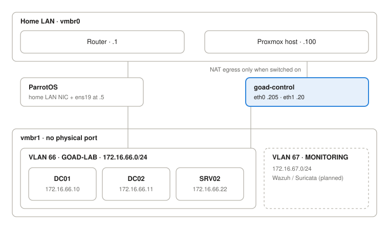

# GOAD on Proxmox, Part 1: Isolated Network & Windows Template

Nov 2, 2026 · @NickP3lle

## About the project

I'm building [Game of Active Directory (GOAD)](https://github.com/Orange-Cyberdefense/GOAD) GOAD-Light on a Proxmox host, with the intention of attacking it myself to practice penetration testing practices on Active Directory. This part covers the initial phase of deployment of the lab: an isolated lab network, a control node, Proxmox API access, and a working Windows Server 2019 Packer template.

GOAD-Light is the smallest full GOAD variant: 3 Windows VMs, 1 forest, 2 domains. This is the most a 16 GB host can carry with room left for an attacker box and, later, a monitoring stack.

The project runs in five phases:

1. Assess the host and pick the GOAD variant
2. Deploy the lab, with snapshots
3. Attack the lab, technique by technique
4. Configure detection for each attack (Wazuh / Suricata)
5. Optionally map attack → detection → mitigation to MITRE ATT&CK

**Note:** GOAD is deliberately vulnerable: never expose it to the internet or to a network you share with other people.

## Network design: isolated by construction

The lab lives on a second Linux bridge, `vmbr1`, with no physical port attached, so that lab traffic cannot reach the external network.

```
# /etc/network/interfaces (Proxmox host)
auto vmbr1
iface vmbr1 inet manual
    bridge-ports none
    bridge-stp off
    bridge-fd 0
    bridge-vlan-aware yes
    bridge-vids 66,67
```

Apply with `ifreload -a`. This touches only `vmbr1`, so there is no risk of losing access to the web UI on `vmbr0`.

| VLAN | Name | Subnet | Purpose |
| --- | --- | --- | --- |
| 66 | GOAD-LAB | 172.16.66.0/24 | Lab targets, attacker box, control node |
| 67 | MONITORING | 172.16.67.0/24 | Wazuh / Suricata (not built yet) |

Neither VLAN has a router. The only way out of VLAN 66 is a temporary NAT window on the control node, covered later in this post.



Only ParrotOS and goad-control touch both networks. goad-control forwards lab traffic to the internet only while its NAT script is on.

**IP plan for VLAN 66**

| Address | Host | Notes |
| --- | --- | --- |
| .5 | ParrotOS (second NIC) | Attacker box, static, no gateway |
| .10 | DC01 | GOAD-Light, set by Terraform |
| .11 | DC02 | GOAD-Light, set by Terraform |
| .20 | goad-control | Ansible/Terraform/Packer, DHCP server, temporary NAT gateway |
| .22 | SRV02 | GOAD-Light, set by Terraform |
| .100–.150 | dnsmasq DHCP pool | Only used while building templates |

**Attacker box.** ParrotOS has a dedicated vNIC on the lab VLAN:

```bash
qm set <parrot_vm_id> --net1 virtio,bridge=vmbr1,tag=66
```

Inside Parrot, the new interface gets `172.16.66.5/24` with no gateway and no DNS, so Parrot's internet route stays on its primary NIC by editing `/etc/network/interfaces`:

```bash
# /etc/network/interfaces
auto ens19
iface ens19 inet static
    address 172.16.66.5/24
```

## The control node "goad-control"

All the automation (Packer, Terraform, Ansible, GOAD's own scripts) runs from one Debian 12 LXC container.

It has two NICs: `eth0` on the home LAN to reach the Proxmox API, and `eth1` on VLAN 66 to reach the lab.

```bash
pct create 205 local:vztmpl/debian-12-standard_12.*_amd64.tar.zst \
  --hostname goad-control --unprivileged 1 --features nesting=1 \
  --cores 1 --memory 1024 --swap 0 \
  --rootfs local-lvm:8 \
  --net0 name=eth0,bridge=vmbr0,ip=<eth0>.205/24,gw=<eth0>.1 \
  --net1 name=eth1,bridge=vmbr1,tag=66,ip=172.16.66.20/24
```

`nesting=1` is required: without it, systemd 252 in Debian 12 does not run properly inside the container. If the container already exists, `pct set 205 -features nesting=1` adds it.

**Tooling.** Packer and Terraform.

```bash
apt install -y gnupg curl lsb-release git
curl -fsSL https://apt.releases.hashicorp.com/gpg | gpg --dearmor -o /usr/share/keyrings/hashicorp-archive-keyring.gpg
echo "deb [signed-by=/usr/share/keyrings/hashicorp-archive-keyring.gpg] https://apt.releases.hashicorp.com $(lsb_release -cs) main" \
  > /etc/apt/sources.list.d/hashicorp.list
apt update && apt install -y packer terraform
```

- Ansible: apt (apt install -y ansible)
- GOAD: `git clone https://github.com/Orange-Cyberdefense/GOAD.git /root/GOAD`

**DHCP for template builds.** Windows Setup expects DHCP during the Packer build, and VLAN 66 has no router to provide it. So the container runs dnsmasq in DHCP-only mode, bound strictly to `eth1`, handing out addresses with no gateway and no DNS so isolation holds.

```
# /etc/dnsmasq.d/goad-build.conf
port=0                 # DNS server disabled, DHCP only
interface=eth1
bind-interfaces
except-interface=eth0  # No DHCP on eth0 interface
dhcp-range=172.16.66.100,172.16.66.150,255.255.255.0,12h
dhcp-option=3          # empty router option: no gateway handed out
dhcp-option=6          # empty DNS option: no resolver handed out
```

## Proxmox API access

Packer and Terraform both authenticate as `terraform@pve` with an API token, under a custom role scoped to what VM templating and cloning actually need.

```bash
# Resource pool the lab VMs and template land in
pveum pool add GOAD

# Service user + custom role
pveum user add terraform@pve
pveum role add TerraformProv -privs "VM.Allocate,VM.Clone,VM.Config.CDROM,VM.Config.CPU,VM.Config.Cloudinit,VM.Config.Disk,VM.Config.HWType,VM.Config.Memory,VM.Config.Network,VM.Config.Options,VM.Console,VM.Audit,VM.PowerMgmt,VM.GuestAgent.Audit,VM.GuestAgent.Unrestricted,Datastore.AllocateSpace,Datastore.AllocateTemplate,Datastore.Audit,Sys.Audit,Sys.Console,Sys.Modify,SDN.Use"
pveum aclmod / -user terraform@pve -role TerraformProv

# API token; privsep 0 = the token inherits the user's permissions
pveum user token add terraform@pve provider --privsep 0
```

The token ID is `terraform@pve!provider`. The secret is shown once; it goes into a git-ignored variables file, never into the repo.

**`VM.Monitor` is deprecated in PVE 9.** Many older guides list `VM.Monitor`. It was removed in Proxmox VE 9.0 and split into `VM.GuestAgent.*` plus `Sys.Audit` / `Sys.Modify`. Copying an old privilege list fails on it.

## Building the Windows Server 2019 template with Packer

The final build produced template **9000** (`WinServer2019x64-cloudinit`). All paths below are relative to `/root/GOAD/packer/proxmox/`.

### 1. Get every ISO and installer in place

Several of these were silently missing on my first runs.

| File | Where it ends up | Source |
| --- | --- | --- |
| Windows Server 2019 eval ISO | `local:iso/windows_server2019_x64FREE_en-us.iso` | Microsoft Evaluation Center https://www.microsoft.com/en-us/evalcenter/evaluate-windows-server-2019 |
| `virtio-win.iso` | `local:iso/virtio-win.iso` | [fedorapeople.org stable virtio-win](https://fedorapeople.org/groups/virt/virtio-win/direct-downloads/stable-virtio/virtio-win.iso) |
| `CloudbaseInitSetup_Stable_x64.msi` | `scripts/sysprep/` (before building the ISOs) | [cloudbase.it](https://www.cloudbase.it/downloads/CloudbaseInitSetup_Stable_x64.msi) |
| `Autounattend_winserver2019_cloudinit.iso` | `./iso/`, uploaded by Packer itself | Built by the repo's `build_proxmox_iso.sh` |
| `scripts_withcloudinit.iso` | `local:iso/scripts_withcloudinit.iso` | Built locally, then copied to the host by hand |

```bash
cd /root/GOAD/packer/proxmox/scripts/sysprep/
wget https://www.cloudbase.it/downloads/CloudbaseInitSetup_Stable_x64.msi
cd /root/GOAD/packer/proxmox/
./build_proxmox_iso.sh
pct pull <CTID> ./iso/scripts_withcloudinit.iso /var/lib/vz/template/iso/scripts_withcloudinit.iso
sha256sum ./iso/Autounattend_winserver2019_cloudinit.iso   # goes into autounattend_checksum
```

### 2. Proxmox connection: `config.auto.pkrvars.hcl`

```
proxmox_url             = "https://<proxmox_ip>:8006/api2/json"
proxmox_username        = "terraform@pve!provider"
proxmox_token           = "<secret_token>"
proxmox_skip_tls_verify = "true"
proxmox_node            = "pve"
proxmox_pool            = "GOAD"
proxmox_iso_storage     = "local"
proxmox_vm_storage      = "local-lvm"
```

This file holds a secret. Check it is ignored before any commit:

```bash
git check-ignore -v packer/proxmox/config.auto.pkrvars.hcl || echo "NOT IGNORED"
```

### 3. Template variables: `windows_server2019_proxmox_cloudinit.pkvars.hcl`

| Variable | Value |
| --- | --- |
| `vm_name` | `WinServer2019x64-cloudinit` |
| `iso_file` | `local:iso/windows_server2019_x64FREE_en-us.iso` |
| `vm_disk_format` | `raw` |
| `autounattend_checksum` | `sha256:8f930eb1c08def6243d7bcfb72a6f931cf842e4c6055c5ced01f42cd1580bdf8` |

### 4. Variable declarations: `variables.pkr.hcl`

```hcl
variable "proxmox_token" {
  type      = string
  sensitive = true
}

variable "proxmox_password" {   # no longer used, but still declared upstream
  type    = string
  default = null
}

variable "vm_id" {
  type    = string
  default = "9000"
}
```

### 5. The build definition: `packer.json.pkr.hcl`

Two values are hard-coded upstream rather than exposed as variables, which makes them easy to miss:

```
  network_adapters {
    bridge   = "vmbr1"   # upstream: vmbr3
    model    = "virtio"
    vlan_tag = "66"      # upstream: "10"
  }
  token = "${var.proxmox_token}"   # replaces: password = "${var.proxmox_password}"
```

### 6. The sysprep step: `scripts/sysprep/cloudbase-init-p2.ps1`

The last provisioner runs sysprep. It must generalize and then **exit**, not power off the VM:

```powershell
start-process -FilePath "C:/Windows/system32/sysprep/sysprep.exe" `
  -ArgumentList "/generalize /oobe /mode:vm /quit /unattend:cloudbase-init-unattend.xml" -wait
```

With `/quit` and `-wait`, the script returns cleanly and Packer's Proxmox builder shuts the VM down itself before converting it to a template.

### 7. Build

```bash
cd /root/GOAD/packer/proxmox
packer init .
packer validate -var-file=windows_server2019_proxmox_cloudinit.pkvars.hcl .
PACKER_LOG=1 PACKER_LOG_PATH=build-$(date +%F-%H%M).log \
  packer build -on-error=abort -var-file=windows_server2019_proxmox_cloudinit.pkvars.hcl .
```

`-on-error=abort` keeps a failed VM around for inspection. Remove it before retrying with `qm stop 9000 && qm destroy 9000`, after checking that 9000 is the half-built VM and nothing else.

A successful run ends with *Stopping VM → Converting VM to template → Adding a cloud-init cdrom*.

## Preparing GOAD-Light for deployment

### RAM sizing: `ad/GOAD-Light/providers/proxmox/windows.tf`

| VM | vm\_id | Stock RAM | My RAM | IP |
| --- | --- | --- | --- | --- |
| DC01 | 9001 | 3096 MB | 2560 MB | 172.16.66.10 |
| DC02 | 9002 | 3096 MB | 2560 MB | 172.16.66.11 |
| SRV02 | 9003 | 6240 MB | 2048 MB | 172.16.66.22 |

The three VMs total about 7 GB, leaving room for the host, the control node and Parrot on 16 GB.

### Temporary internet egress via the control node

The Windows VMs need internet twice: during Ansible provisioning (GOAD downloads installers onto the targets, e.g. SQL Server Express on SRV02) and for Windows activation. Parrot doesn't need a gateway to attack, because it's on the same layer-2 segment as the targets.

Goad-control already sits on both networks, so it does the NAT. That keeps the Proxmox host itself off the lab VLAN. The script is runtime-only: restarting the container turns NAT off.

```bash
#!/usr/bin/env bash
# /root/lab-nat.sh on|off|status — run INSIDE CT 205.
# Temporary internet egress for GOAD VLAN 66 during provisioning/activation.
# Runtime-only: container restart = off.
set -euo pipefail
LAB_NET=172.16.66.0/24; LAB_IF=eth1; WAN_IF=eth0; HOME_NET=192.168.100.0/24

add_rule() { local t=$1 c=$2; shift 2; iptables -t "$t" -C "$c" "$@" 2>/dev/null || iptables -t "$t" -I "$c" "$@"; }
del_rule() { local t=$1 c=$2; shift 2; while iptables -t "$t" -C "$c" "$@" 2>/dev/null; do iptables -t "$t" -D "$c" "$@"; done; }

case "${1:-status}" in
  on)
    add_rule filter FORWARD -i "$LAB_IF" -d "$HOME_NET" -j DROP          # lab -> home LAN: blocked
    add_rule nat POSTROUTING -s "$LAB_NET" -o "$WAN_IF" -j MASQUERADE
    sysctl -qw net.ipv4.ip_forward=1
    echo "NAT ON" ;;
  off)
    sysctl -qw net.ipv4.ip_forward=0
    del_rule nat POSTROUTING -s "$LAB_NET" -o "$WAN_IF" -j MASQUERADE
    del_rule filter FORWARD -i "$LAB_IF" -d "$HOME_NET" -j DROP
    echo "NAT OFF" ;;
  status)
    echo "ip_forward=$(sysctl -n net.ipv4.ip_forward)"
    iptables -t nat -S POSTROUTING | grep -F "$LAB_NET" || echo "no MASQUERADE rule"
    iptables -S FORWARD | grep -F "$HOME_NET" || echo "no home-LAN block" ;;
esac
```

**Testing it before GOAD depends on it.** From Parrot, a single-host route forces traffic through goad-control container without touching Parrot's normal internet path:

```bash
# egress works: replies come back through the goad-control container
sudo ip route add 1.1.1.1/32 via 172.16.66.20 dev ens19
ping -c3 1.1.1.1                  # 3/3 received, ~14 ms
sudo ip route del 1.1.1.1/32

# home LAN is blocked: silent drop, no replies
sudo ip route add <eth0>.1/32 via 172.16.66.20 dev ens19
ping -c3 <eth0>.1           # 100% loss
sudo ip route del <eth0>.1/32
```

## Where things stand

The template is built, the network is isolated and tested, and the GOAD config is edited. Part 2 starts with the actual deployment.

**Goals for Part 2**

- [ ] The deployment config is verified and versioned: Terraform applies the intended VM IDs, IPs, gateway and DNS, and every change is committed with no secrets in history
- [ ] GOAD-Light is deployed and fully provisioned, with DC01, DC02 and SRV02 reachable at `.10`, `.11` and `.22`
- [ ] Every lab VM is activated, and VLAN 66 is back to full isolation: no internet, no route to the home LAN
- [ ] A clean pre-attack baseline exists as one set of snapshots that restores all three VMs together

After that: attacks (phase 3), detections (phase 4) and the MITRE ATT&CK mapping (phase 5).

## Sources

- [Orange-Cyberdefense/GOAD](https://github.com/Orange-Cyberdefense/GOAD)
- [GOAD on Proxmox (Mayfly)](https://mayfly277.github.io/posts/GOAD-on-proxmox-part2-packer/)
- [Proxmox Lab: GOAD – Creating VM Templates (0xBEN)](https://benheater.com/proxmox-lab-goad-creating-vm-templates/)
- [Proxmox Lab: GOAD – Installing the Lab (0xBEN)](https://benheater.com/proxmox-lab-goad-installing-the-lab/)
- [EnsoIT packer-windows-proxmox](https://github.com/EnsoIT/packer-windows-proxmox/blob/main/windows-2022-template.pkr.hcl)
